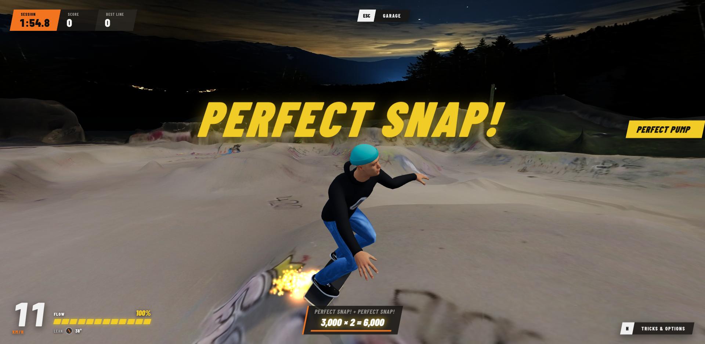

# Surfskate Im Gefilde 🛹🌊

A realistic 3D WebGL surfskate simulator set in the real-world **Skatepark "Im Gefilde"** in Munich/Neubiberg, Germany. Built with **Three.js**, **TypeScript**, and **Vite**.



---

## 🎮 Highlights & Features

- **Authentic Surfskate Physics**:
  - **Dynamic Pumping**: Pumping up and down transitions builds real speed (just like on actual surfskate trucks such as Carver C7 / YOW Meraki), while flat ground requires deliberate rail carving.
  - **Transition & Wall Gravity**: Realistic momentum conservation prevents climbing high vertical walls at low speeds; carving into wall pockets converts vertical speed into lateral drive.
  - **Sharp Surf Carves**: Responsive dual-pivot front truck steering enables tight cutbacks and flowing figure-8 lines.
- **The "SNAP" Trick**:
  - Perform high-speed lip snaps at the crest of transitions.
  - Features dynamic slow-motion time dilation, camera zoom, and on-screen score prompts.
- **Realistic Rigged Skater & IK**:
  - Full skeletal humanoid model with real-time inverse kinematics (IK) anchoring feet to the deck.
  - Dynamic procedural body compression (crouch), upper-body counter-rotation, and extreme rail lean.
- **Real-World Photogrammetry & LiDAR Park**:
  - 3D reconstruction generated from drone and action camera photogrammetry.
  - Combined with official Bavarian DGM1 LiDAR elevation data for smooth, accurate wheel collision.
- **Procedural Audio Engine**:
  - 100% synthesized in real time via the Web Audio API — featuring granular urethane wheel roll, transition hiss, and band-passed airy swooshes for snaps.
- **Atmospheric Environment**:
  - Starry night sky dome, Munich skyline panorama, and HDR environmental lighting.

---

## 🕹️ Controls

| Action | Keyboard |
| :--- | :--- |
| **Push off** | <kbd>W</kbd> / <kbd>↑</kbd> — a single kick, **only from a standstill** |
| **Carve / Pump** | <kbd>A</kbd> <kbd>D</kbd> or <kbd>←</kbd> <kbd>→</kbd> — alternate left/right in rhythm (≈ 1 left-right cycle per second) to pump speed |
| **Wall pump** | Automatic stretch on the way up, compression on the way down; hold <kbd>S</kbd> / <kbd>Shift</kbd> while dropping down a wall to pump harder |
| **SNAP** | <kbd>Q</kbd> at the top of a wall within the right speed window |
| **LAYBACK** | Hold <kbd>F</kbd> during a fast, deep turn |
| **BERTSLIDE** | Hold <kbd>C</kbd> while leaning into a turn |
| **FS REVERSE 360** | <kbd>E</kbd> while carving frontside (<kbd>→</kbd>) with speed |
| **Ollie** | <kbd>Space</kbd> |
| **Camera / Truck feel / Auto-shred** | <kbd>V</kbd> / <kbd>T</kbd> / <kbd>P</kbd> |
| **Reset session** | <kbd>X</kbd> / <kbd>Backspace</kbd> |

Only the four tricks score points. Each landed trick triggers a zoom-in, slow motion, its name on screen and a cinematic swoosh.

---

## 🚀 Getting Started

### Prerequisites
- Node.js (v18 or higher recommended)
- npm

### Installation
```bash
git clone https://github.com/michikarg-ai/surfsk8_game.git
cd surfsk8_game
npm install
```

### Running Locally
```bash
npm run dev
```
Open `http://localhost:5173` in your browser.

### Building for Production
```bash
npm run build
```
The compiled, optimized production bundle will be in `dist/`.

---

## 📁 Project Architecture

```
surfskate_game/
├── index.html                   # Game entry point and HUD overlays
├── public/
│   ├── env/                     # HDRI environment map
│   ├── models/
│   │   ├── skatepark_multi.glb  # 3D photogrammetry park mesh
│   │   ├── im_gefilde_lidar.json# LiDAR elevation grid for physical collision
│   │   └── skater.glb           # Rigged skater + procedural surfskate board
│   └── textures/                # Color maps and night sky dome
├── scripts/                     # Python & Swift asset processing tools
│   ├── build_park.py            # LiDAR & mesh processing
│   ├── build_skater_makehuman.py# CC0 MakeHuman/MPFB character & gear builder
│   └── photogrammetry_cli.swift # Apple Object Capture photogrammetry tool
├── src/
│   ├── audio/SurfAudio.ts       # Web Audio API procedural sound synthesizer
│   ├── camera/SurfCamera.ts     # Smooth trailing surf action camera
│   ├── entities/SkaterVisuals.ts# Skater skeletal posing and leg IK
│   ├── physics/
│   │   ├── ParkSurface.ts       # Heightfield, slope & normal collision
│   │   └── SurfskateController.ts# Surfskate kinematics and trick logic
│   ├── ui/SurfHUD.ts            # HUD displays and score notifications
│   ├── world/ImGefildeScene.ts  # Three.js scene graph, lights, and sky dome
│   └── main.ts                  # Main game loop and input routing
└── vite.config.ts
```

---

## ⚖️ Assets, Licenses & Attributions

When publishing or distributing this game, keep the following license terms and asset origins in mind:

### 1. Codebase
- **Source Code**: MIT License.
- **Three.js**: MIT License (Copyright © 2010-2026 Three.js authors).
- **Vite**: MIT License.

### 2. The Surfskate Board
- **100% Custom / Procedural**: The surfskate deck, concave profile, kicktail, Carver-style swing-arm front truck, rear truck, urethane wheels, bearings, and bushings were generated purely via mathematical formulas in `scripts/build_skater.py`.
- No third-party copyright applies to the board geometry.

### 3. Skater Character Model
- **100% CC0 (Public Domain)**: Generated with the official MakeHuman / MPFB 2 Blender extension (`scripts/build_skater_makehuman.py`) using only official CC0 MakeHuman system and skin asset packs (`makehuman_system_assets`, `skins02`) plus procedurally generated skate gear (turquoise knit skater beanie, hoodie collar/hood, and knee pads).
- Free for unrestricted commercial and non-commercial publishing with no attribution or third-party terms required.

### 4. Skatepark Photogrammetry & Geodata
- **Photogrammetry 3D Mesh**: Reconstructed from drone and camera video footage recorded at the public skatepark "Im Gefilde" in Neubiberg/Munich (*Panoramafreiheit* / Freedom of Panorama applies under § 59 German UrhG).
- **LiDAR & Aerial Elevation Data**: Derived from DGM1 / DOP20 data provided by the Bavarian Surveying and Cadastre Administration:
  - *Data source*: Geodaten © [Bayerische Vermessungsverwaltung](https://vermessung.bayern.de/) (dl-de/by-2-0).

### 5. Sound Effects & Music
- **100% Procedural Web Audio API**: All sounds (wheel rolling hiss, carve crunch, SNAP airy swooshes) are synthesized mathematically on the fly in `src/audio/SurfAudio.ts`. No copyrighted audio samples are used.

### 6. Environment & Sky
- HDRI sky background licensed under CC0 (Public Domain via Poly Haven).

### 7. Fonts
- **Rubik Dirt**, **Permanent Marker** and **Sedgwick Ave Display** (self-hosted in `public/fonts/`, from Google Fonts) are licensed under the [SIL Open Font License 1.1](https://openfontlicense.org/) — free for commercial use and redistribution.
