# SRFSK8 — Wissenschaftliches Game-Engagement- & Langzeitmotivations-Konzept

> **Status:** Konzept-Analyse & Feature-Roadmap (Issue [#16](https://github.com/michikarg-ai/surfsk8_game/issues/16))  
> **Fokus:** Kurzfristiger Spielspaß (*Micro-Loop*), „Nur-noch-eine-Runde“-Sogwirkung (*Mid-Loop*) & langfristige Spielerbindung (*Macro-Loop*)  
> **Basis:** Sport-/Spielpsychologie (Flow-Theorie, Self-Determination Theory, Game Feel, Behavioral Compulsion Loops, MDA-Framework) & Genre-Benchmarks (*Tony Hawk's Pro Skater 1+2*, *Alto's Odyssey*, *OlliOlli World*, *Lonely Mountains: Downhill*)

---

## 1. Executive Summary & Diagnose des Status Quo von SRFSK8

**SRFSK8** besitzt bereits ein starkes technisches und atmosphärisches Fundament: eine physikalisch glaubwürdige Surfskate-Kinematik (Dual-Axis Front-Truck-Geometrie, Flat-Pumping, Wall-Pumping mit Kompression/Extension), zwei reale, per LiDAR/Photogrammetrie gescannte 3D-Skateparks (*Im Wiesengrund / Im Gefilde* und *Airport Skatepark*), zwei spielbare Charaktere (*Lukas* & *Sophie*), eine 2-Minuten-Highscore-Session mit Combo-Timer und Flow-Meter sowie erste Park-Elemente (5 Brezeln pro Session, eine „Follow the Flow“-Line, Ambient-Events wie Flugzeug-Überflüge und Scooter-NPC).

### Warum flacht die Motivation aktuell nach wenigen Minuten ab?

Analysiert man den aktuellen Stand über die **drei Zeithorizonte moderner Game-Loops**, zeigt sich ein klares strukturelles Ungleichgewicht:

| Zeithorizont | Aktueller Stand in `SRFSK8` | Psychologische & spielmechanische Lücke (Diagnose) |
| :--- | :--- | :--- |
| **Micro-Loop** *(0 – 15 Sek.: Moment-to-Moment Gameplay)* | Physikalisch sauberes Carven, Pumpen & 5 Kern-Tricks (`SNAP`, `LAYBACK`, `BERTSLIDE`, `REVERSE360`, `INDYGRAB`). Slow-Mo & Zoom bei SNAPs. | **Fehlende Eskalation & Umwelt-Resonanz:** Ob der Spieler bei 20 % oder 100 % Flow fährt, verändert das audiovisuelle Gefühl kaum. Beim Pumpen in Transitions fehlt direktes Timing-Feedback (*Perfect Pump*). Es gibt keine benannten Park-Gaps (*Transfers*), die zum kreativen Lesen der Park-Architektur einladen. |
| **Mid-Loop** *(15 Sek. – 2 Min.: Eine Session / ein Run)* | 2-Minuten-Timer, Highscore-Jagd, 5 statisch platzierte Brezeln (+2.500 Punkte Bonus), 1 feste „Follow the Flow“-Line (+2.000 Punkte). | **Statische Zielstruktur & fehlender „Near-Miss“-Sog:** Nach 2–3 Runden hat der Spieler alle 5 Brezeln gefunden und die einzige Flow-Line gemeistert. Danach bleibt nur ein abstrakter Zahlen-Highscore ohne konkrete Teilziele (*Micro-Goals*) oder Risiko-Dilemmata. |
| **Macro-Loop** *(> 10 Min. / über Sessions hinweg)* | Landing-Page mit Auswahl aus 2 Skatern, 2 Parks; Board-Kategorie zeigt lediglich den Hinweis *„More boards on Instagram“*. | **Kompletter Wegfall von Meta-Progression:** Es wird nichts freigeschaltet, kein Rang aufgebaut, keine Mission abgehakt und kein Board individualisiert. Nach Ende der 2 Minuten fällt der Spieler auf Null zurück. |

**Kern-Erkenntnis:** *SRFSK8 hat bereits einen guten kinetischen Kern („Toy-Qualität“), aber noch kein geschichtetes Ziel- und Belohnungssystem („Game-Qualität“), das den Spieler von einer kurzen Neugier-Session in eine stundenlange Meisterschafts-Spirale zieht.*

---

## 2. Wissenschaftliches Fundament: Was macht Spiele kurz- und langfristig fesselnd?

Um gezielte, wirksame Verbesserungen abzuleiten, stützen wir uns auf fünf empirisch validierte Modelle der Spielwissenschaft und Motivationspsychologie:

### 2.1 Flow-Theorie & das *GameFlow*-Modell (Csikszentmihalyi, 1990; Sweetser & Wyeth, 2005)
Mihaly Csikszentmihalyi beschreibt **Flow** als den Zustand völligen Aufgehens in einer Tätigkeit, der genau dann entsteht, wenn die **wahrgenommene Herausforderung (*Challenge*)** und die **eigenen Fähigkeiten (*Skill*)** in einem dynamischen Gleichgewicht stehen (dem *Flow-Kanal*):
- Ist die Herausforderung zu niedrig bei steigendem Können, entsteht **Langeweile (Boredom)** — *genau das passiert in SRFSK8 nach ca. 5 Minuten, weil weder die Flow-Line noch die Brezel-Jagd mit dem Können des Spielers mitwachsen.*
- Ist die Herausforderung zu hoch, entsteht **Frustration/Angst (Anxiety)**.

**Sweetser & Wyeth (2005)** übertrugen dies im meistzitierten Evaluationsmodell **GameFlow** (*ACM Computers in Entertainment*) auf acht Kerndimensionen für Videospiele:
1. **Concentration:** Reichhaltige, relevante Reize ohne kognitive Überfrachtung.
2. **Challenge:** Gestufte Schwierigkeitsgrade, die mit dem Spieler mitwachsen.
3. **Player Skills:** Spürbarer Lernfortschritt und wachsende Meisterschaft ohne steile Einstiegshürde.
4. **Control:** Direkte, verzögerungsfreie Übersetzung von Intention in Bewegung.
5. **Clear Goals:** Jederzeit klare übergeordnete **und** unmittelbare Teilziele.
6. **Immediate Feedback:** Unmittelbare Rückmeldung über Erfolg, Fehler und Annäherung ans Ziel.
7. **Immersion:** Verschmelzung von Audio, Bewegung und Umwelt zu einer spürbaren Atmosphäre.
8. **Social Interaction:** Vergleichbarkeit, Wettbewerb oder geteilte Erlebnisse.

### 2.2 Self-Determination Theory (SDT) in Videospielen (Ryan, Rigby & Przybylski, 2006)
In ihrer wegweisenden Studie *"The Motivational Pull of Video Games: A Self-Determination Theory Approach"* (*Motivation and Emotion*, 2006) wiesen Richard Ryan, C. Scott Rigby und Andrew Przybylski über mehrere experimentelle Studien nach, dass langfristige intrinsische Spielmotivation und Wiederspielwert (*Retention*) direkt davon abhängen, wie stark ein Spiel drei psychologische Grundbedürfnisse befriedigt:

1. **Competence (Kompetenz & Meisterschaft):**
   - Das Bedürfnis, sich wirksam, geschickt und wachsend kompetent zu fühlen.
   - *Implikation für SRFSK8:* Der Spieler muss nicht nur Punkte sehen, sondern spüren, **warum** ein Carve perfekt war (*Perfect Pump*, *Clean Gap Landing*), und durch sichtbare Ränge/Medaillen (Bronze → Silber → Gold) Kompetenzwachstum erleben.
2. **Autonomy (Autonomie & Selbstbestimmung):**
   - Das Gefühl von Wahlfreiheit, eigenem Ausdruck (*Self-Expression*) und Kontrolle über die eigenen Ziele und Werkzeuge.
   - *Implikation für SRFSK8:* Spieler wollen ihren eigenen Stil ausdrücken — durch verschiedene **Spielmodi** (Highscore-Run vs. gechillter Free-Surf ohne Timer), durch wählbare **Missionen/Lines** und durch eine **Surfskate-Garage** (Decks mit unterschiedlichem Wheelbase-Charakter, Rollen, Designs).
3. **Relatedness (Soziale Verbundenheit & Kontext):**
   - Das Gefühl, Teil einer lebendigen Welt oder Community zu sein und sich mit anderen zu messen.
   - *Implikation für SRFSK8:* Auch ohne komplexen Echtzeit-Multiplayer schaffen **Ghost-Skater** (gegen den eigenen besten Lauf oder einen hinterlegten „Pro-Local-Ghost“ fahren), **lokale/globale Bestenlisten** und reaktive NPCs am Bowl-Rand sofortige soziale Resonanz.

### 2.3 „Game Feel“ & Multisensorischer „Juice“ (Steve Swink, 2008; Jesse Schell, 2008)
Steve Swink definiert in *Game Feel: A Game Designer's Guide to Virtual Sensation* (2008) den sekundenschnellen Genuss von Bewegungsspielen über drei Säulen: **Real-Time Control**, **Simulated Space** und **Polish („Juice“)**.
- **Das 50–200ms-Feedback-Fenster:** Jede gelungene physische Aktion (ein tiefer Bottom-Turn, das Auspressen einer steilen Transition, das Einrasten am Coping) muss innerhalb von unter 200 Millisekunden durch ein synchrones Zusammenspiel aus **Kamera** (leichter FOV-Kick, dynamischer Roll-Winkel), **Audio** (Tonhöhe des Urethan-Rollgeräuschs, Windrauschen, Musik-Filteröffnung) und **Visuellem Effekt** (Speed-Lines, Urethan-Spuren im Asphalt bei Bert Slides) belohnt werden.
- Swink zeigt: In Sport- und Skateboard-Spielen entsteht 70 % der Kurzzeit-Faszination allein daraus, dass sich schon das **ziellose Fahren im Kreis** durch perfektes kinetisches Feedback belohnend anfühlt.

### 2.4 Geschichtete Zielsysteme, *Near-Miss-Effekt* & Compulsion Loops (Loftus & Loftus, 1983; Koster, 2004; Eyal, 2014)
Warum sagen Spieler um 23:30 Uhr *„Nur noch eine einzige Runde!“* (*One-More-Try-Effekt*)?
- **Zeigarnik-Effekt & überlappende Ziel-Horizonte:** Unser Gehirn behält unerledigte Aufgaben in aktiver kognitiver Spannung. Die erfolgreichsten Spiele beenden eine Runde **nie** so, dass alle Ziele gleichzeitig abgeschlossen sind. Wenn der 2-Minuten-Timer abläuft, sollte der Spieler z. B. Mission A geschafft haben, aber bei Mission B auf **4 von 5 SNAPs** stehen (*80 % Completion*).
- **Der Near-Miss-Effekt (Fast-Treffer):** Psychologische Studien (u. a. Reid, 1986; Kassinopoulos et al.) belegen, dass ein *knapp verfehltes Ziel* („Nur noch 350 Punkte bis zum Gold-Rang!“, „Fast das letzte Gate der Pro-Line erreicht!“) das dopaminerge Belohnungssystem stärker zur sofortigen Wiederholung aktiviert als ein leichter Sieg.

### 2.5 Das MDA-Framework (Hunicke, LeBlanc & Zubek, 2004)
Das **Mechanics-Dynamics-Aesthetics (MDA)** Framework verdeutlicht, dass erfolgreiche Sportspiele mehrere ästhetische Erfahrungsdimensionen gleichzeitig bedienen müssen:
- **Sensation** (Game as sense-pleasure: Das Rauschen und der Rhythmus des Surfskatens)
- **Challenge** (Game as obstacle course: Die knallharte Pro-Line oder die 20.000-Punkte-Session)
- **Discovery** (Game as uncharted territory: Versteckte Transfers und Gaps im Park entdecken)
- **Expression** (Game as self-discovery: Eigenes Board-Setup und eigener Fahrstil)
- **Submission / Pastime** (Game as relaxation: Endloses Feierabend-Cruisen im Sonnenuntergang ohne Zeitdruck)

---

## 3. Benchmark-Analyse: Wie lösen die besten Genre-Spiele dieses Problem?

Wir haben vier herausragende Genre-Referenzen analysiert und deren Kernmechaniken direkt auf ihre Übertragbarkeit für `SRFSK8` untersucht:

| Referenzspiel | Kernmechanik für Kurzzeit-Spaß (Micro/Mid) | Kernmechanik für Langzeit-Bindung (Macro) | Direkter Transfer auf `SRFSK8` |
| :--- | :--- | :--- | :--- |
| **Tony Hawk’s Pro Skater 1+2** *(Vicarious Visions / Neversoft)* | **Parallele Park-Ziele im 2-Minuten-Run** (Highscore, Pro Score, Sick Score, S-K-A-T-E sammeln, Park-Objekte triggern) + **Benannte Park-Gaps** (z. B. *„Over the Pipe“*), die als blaue Kamera-Callouts aufblitzen. | **Gap-Checkliste pro Park** & Freischaltung neuer Level, Decks und Skater-Stats durch erledigte Park-Ziele. | **Named Park Gaps & Transfers** in *Im Wiesengrund* und *Airport* + gestufte Score-Medaillen (Rookie / Pro / Sick Score). |
| **Alto’s Odyssey** *(Snowman / Team Alto)* | **Risk/Reward-Momentum:** Wallrides, Backflips und Grinds geben einen kurzen Speed-Boost & schützen vor Felsen; dynamisches Wetter & Tageszeiten erzeugen Gänsehaut-Flow. | **Das „3-Goals-per-Rank“-System:** Immer genau 3 handliche Missionen gleichzeitig aktiv. Sind alle 3 gelöst, steigt man im Level auf (z. B. *Level 1 → Level 2*) und schaltet neue Boards/Modi frei; zusätzlich **Zen-Mode** ohne Score/Timer. | **Dynamisches 3-Missionen-System („Surf-Challenges“)** + **Skater-Rang** + **Free-Surf Zen Mode** ohne 2-Minuten-Timer. |
| **OlliOlli World** *(Roll7)* | **Rhythmischer Flow & Instant-Restart:** Butterweiche Verbindung von Pumpen, Grabs und Wallrides; eine Taste setzt den Spieler in < 0,2 Sek. zurück an den Line-Start. | **Mehrstufige Line-Herausforderungen** im selben Park (Standard-Route vs. knifflige *Gnarly Routes*) + umfangreiche Board-/Style-Anpassung. | **3 Schwierigkeitsstufen bei „Follow the Flow“** (🟢 *Chill Line*, 🔵 *Pro Carve Line*, 🔴 *Sick Transfer Line*) + Schnell-Neustart per Taste `R`. |
| **Lonely Mountains: Downhill** *(Megagon Industries)* | **Sektor-Zeiten & Risiko-Abkürzungen:** Der Spieler wählt ständig zwischen der sicheren Hauptlinie und mutigen High-Speed-Abkürzungen über Kanten. | **Ghost-Rennen gegen die eigene Bestleistung** + Freischaltung neuer Rahmen/Lackierungen über gemeisterte Strecken-Challenges. | **Personal-Best Ghost-Skater** auf den Flow-Lines + sichtbare Sektor-/Combo-Splits. |

---

## 4. Konkretes Maßnahmen-Konzept für SRFSK8 (Die 3 Zeithorizonte)

Basierend auf der wissenschaftlichen Diagnose und den Genre-Benchmarks gliedert sich unser Verbesserungskonzept für `SRFSK8` in **drei aufeinander aufbauende Zeithorizonte**:

```mermaid
flowchart LR
    subgraph H1["Horizont 1: Micro-Loop (0–15 Sek.)"]
        M1["🔥 Flow-State Overdrive ('Surf-Zone' ab 80%)"]
        M2["🌊 Perfect-Pump-Timing & Urethan-Spuren"]
        M3["⚡ Named Park Gaps & Transfers (THPS-Style)"]
    end
    subgraph H2["Horizont 2: Mid-Loop (15 Sek.–2 Min.)"]
        D1["🎯 3-Aktive-Missionen-System (Alto-Style)"]
        D2["🛣️ 3 Flow-Lines (Chill / Pro / Sick) + Ghost"]
        D3["🔥 Dynamische 'Hot-Spot'-Walls (3x Score 20s)"]
    end
    subgraph H3["Horizont 3: Macro-Loop (> 15 Min.)"]
        L1["🛹 Surfskate-Garage (Decks, Wheels, Trucks)"]
        L2["🏆 Skater-Rang (Grom bis Soul Surfer)"]
        L3["🌅 3 Spielmodi (Jam / Flow-Cup / Free-Surf Zen)"]
    end
    H1 --> H2 --> H3
```

---

### 4.1 Horizont 1 — Micro-Loop: Sekunden-Spaß, „Game Feel“ & räumliche Entdeckung (0 – 15 Sekunden)

Ziel von Horizont 1 ist es, dass sich **jede einzelne Kurve, jedes Pumpen in der Transition und jeder Sprung über eine Kante** unmittelbar belohnend anfühlt (Swink’s *Game Feel* & Csikszentmihalyi’s *Immediate Feedback*).

#### Maßnahme 1.1: „Surf-Zone“ Overdrive (Audiovisuelles Flow-Eskalationssystem ab 80 % Flow)
- **Problem heute:** Der Flow-Balken im HUD füllt sich von 0 % bis 100 %, hat aber kaum spürbare Auswirkungen auf das Fahrgefühl oder die Spielwelt.
- **Konzept:** Sobald der Spieler durch flüssiges Carven, Pumpen und Tricks **≥ 80 % Flow** erreicht, tritt er in die **„SURF-ZONE“ (Overdrive-State)** ein:
  1. **Visuelles Feedback:** Subtile radiale Speed-Lines am Bildschirmrand, die Kamera öffnet das Field of View (FOV) sanft um `+6°` (höheres Geschwindigkeitsgefühl), und unter den Rollen entsteht ein dezenter cyan-goldener Flow-Trail.
  2. **Akustisches Layering:** Das Rollgeräusch der Urethan-Wheels bekommt ein sattes, surfiges „Singen“ auf dem Beton, das Fahrtwind-Rauschen schwillt an.
  3. **Spielmechanischer Nutzen:** Solange der Spieler über 80 % Flow bleibt, zählt jeder Trick-Basiswert **1,5x**, und die maximale Höchstgeschwindigkeit steigt um `+8 %`, wodurch höhere Airs und weite Transfers möglich werden!

#### Maßnahme 1.2: „Perfect Pump“ Timing-Feedback & Farbige Urethan-Slide-Spuren
- **Problem heute:** Wall-Pumping (`SurfskateController.ts`) funktioniert physikalisch bereits über Kompression beim Drop-In (`S`/`Shift`), aber der Spieler erhält kein klares Feedback, *ob* er den optimalen Scheitelpunkt der Transition getroffen hat.
- **Konzept:**
  1. **Perfect Drop-Pump Callout:** Drückt oder hält der Spieler im oberen Drittel einer steilen Transition beim Umkehrpunkt nach unten im richtigen Zeitfenster die Kompression, gibt es einen knackigen Mini-Impuls (*„⚡ PERFECT PUMP +150“* + kurzes Aufleuchten des vorderen Surf-Trucks + spürbarer Speed-Kick).
  2. **Persistente Urethan-Thanelines & Reifenspuren:** Bei jedem **Bert Slide** (`V`), **Layback** (`G`) oder **SNAP** (`F`) hinterlassen die Hinterrollen farbige Urethan-Schleifspuren (*„Thanelines“*, passend zur gewählten Rollenfarbe) auf dem Beton des Skateparks, die über 45 Sekunden langsam verblassen. So „malt“ der Spieler seine eigene Session sichtbar in den Park (*MDA: Expression & Sensation*).

#### Maßnahme 1.3: „Named Park Gaps & Transfers“ (nach *Tony Hawk’s Pro Skater*)
- **Problem heute:** Die 3D-Skateparks *Im Wiesengrund* und *Airport Skatepark* besitzen spannende Hügel, Volcanoes, Cradles und Hips, aber das Spiel erkennt nicht, wenn der Spieler einen spektakulären Transfer von einer Wand zur anderen springt oder carvt.
- **Konzept:** Wir definieren pro Skatepark **8 bis 10 benannte „Park Gaps“** (Start-Trigger-Zone A → Landung/Durchfahrt in Zone B innerhalb von `1.8s` oder im Air/Carve):
  - **Beispiele für *Im Wiesengrund (Im Gefilde)*:**
    - 🌊 **`SUNSET-TO-VOLCANO TRANSFER`** (+500 Pts): Von der östlichen Sunset-Palm-Wall direkt über den zentralen Volcano in die West-Transition.
    - 🔥 **`CRADLE OVER-VERT CARVE`** (+600 Pts): High-Line mit > 22 km/h durch die steile Nordwest-Cradle ohne Geschwindigkeitsverlust.
    - ⚡ **`VOLCANO AIR GAP`** (+750 Pts): Ollie/Indy-Grab komplett über die Kuppe des Central Volcano.
    - 🥨 **`POCKET-TO-POCKET WHIP`** (+500 Pts): Schneller Richtungswechsel zwischen Süd- und Nord-Pocket in unter 2,5 Sekunden.
  - **Beispiele für *Airport Skatepark*:**
    - ✈️ **`RUNWAY SPINE TRANSFER`** (+700 Pts): Sprung über die zentrale Spine/Hip von Bowl zu Street-Section.
    - 🛫 **`JETWASH HIGH-WALL SNAP`** (+600 Pts): SNAP ganz oben an der höchsten Bowl-Extension.
  - **Gap-Checkliste im HUD-Dock:** Im ausklappbaren Dock (`Taste H`) sieht der Spieler, wie viele der 8 Park-Gaps er bereits entdeckt hat (*z. B. „Park Gaps: 5 / 8 entdeckt“*). Beim **ersten Entdecken** eines neuen Gaps blitzt ein blaues *„✨ NEW GAP DISCOVERED!“*-Banner auf (*SDT: Competence & Discovery*).

---

### 4.2 Horizont 2 — Mid-Loop: Der „Nur-noch-eine-Runde“-Sog in 2-Minuten-Sessions (15 Sek. – 10 Minuten)

Ziel von Horizont 2 ist es, der 2-Minuten-Session eine **abwechslungsreiche, dynamische Struktur** zu geben, sodass kein Lauf wie der andere ist und am Ende jeder Runde mindestens ein greifbares Ziel fast erreicht ist (*Zeigarnik- & Near-Miss-Effekt*).

#### Maßnahme 2.1: Dynamisches 3-Missionen-System („Surf-Challenges“ nach *Alto’s Odyssey*)
- **Problem heute:** In der 2-Minuten-Session gibt es nur das abstrakte Ziel „Mach irgendwie viele Punkte“.
- **Konzept:** Jederzeit hat der Spieler ein **Set aus genau 3 konkreten, handlichen Missionen** (sichtbar auf der Landing-Page vor dem Start, oben rechts kompakt beim Start der Session und in der End-Card nach Ablauf der 2 Minuten):
  - **Beispiel-Set (Stufe 1 — *Grom*):**
    1. ☑️ *Lande 3 saubere SNAPs an beliebigen Wänden (2/3)*
    2. ⬜ *Sammle alle 5 Brezeln in einer einzigen Session (0/1)*
    3. ⬜ *Erreiche eine 2.000-Punkte-Combo ohne Sturz (1.450 / 2.000)*
  - **Beispiel-Set (Stufe 3 — *Local Ripper*):**
    1. ⬜ *Verbinde einen Bert Slide und einen Indy Grab in einer Combo*
    2. ⬜ *Schaffe die „Follow the Flow“-Line in unter 38 Sekunden*
    3. ⬜ *Halte den Flow-Balken für 15 Sekunden durchgehend über 80 %*
- **Warum das den „Nur-noch-eine-Runde“-Sog erzeugt:**
  - Der Fortschritt von kumulativen Zielen (oder das Abhaken einzelner Teilmissionen) bleibt in `localStorage` erhalten.
  - Schließt der Spieler eine Mission während des Laufs ab, erscheint ein goldenes Toast-Banner (*„🎯 CHALLENGE COMPLETE! +500 XP“*).
  - Sind alle 3 Missionen eines Sets erledigt, steigt der Spieler **einen Skater-Rang auf** und erhält sofort 3 neue, etwas anspruchsvollere Missionen.

#### Maßnahme 2.2: Mehrstufige „Follow the Flow“-Lines (🟢 Chill / 🔵 Pro / 🔴 Sick) + Personal-Best Ghost
- **Problem heute:** `FlowLineChallenge.ts` bietet aktuell genau **eine** feste Linie mit 34 Toren im Park *Im Wiesengrund*. Hat man sie einmal geschafft, bietet sie keinen neuen Anreiz mehr, und im *Airport Skatepark* fehlt noch ein abgestimmtes Gegenstück.
- **Konzept:**
  1. **3 wählbare Routen pro Park am Start-Gate** (oder automatischer Aufstieg nach Abschluss):
     - 🟢 **Tour 1: „Soul Carve Line“ (Chill / Einsteiger):** Breite Tore, runder Fluss durch die flacheren Transitions (+1.500 Punkte).
     - 🔵 **Tour 2: „Wall-to-Wall Pump Line“ (Pro):** Führt hoch in die steilen Bowl-Wände und erfordert aktives Wall-Pumping, um die hoch platzierten Tore zu erreichen (+3.000 Punkte).
     - 🔴 **Tour 3: „Sick Transfer & Trick Line“ (Expert):** Kürzere, hochintensive Linie mit **Trick-Gates** (an bestimmten markierten Toren am oberen Wandrand muss ein `SNAP`, `BERTSLIDE` oder `AIR` ausgeführt werden, damit das Tor zählt! +5.000 Punkte).
  2. **Personal-Best Ghost-Skater:**
     - Während einer aktiven Flow-Line-Challenge wird die beste bisher gefahrene Runde des Spielers (mit 5 Hz Position/Yaw/Lean-Samples in `localStorage` gespeichert — nur wenige Kilobyte!) als halbtransparenter, türkis leuchtender **Ghost-Skater** abgespielt.
     - Das Fahren gegen den eigenen Geist aktiviert sofort den **Competence- & Relatedness-Trieb** (*Lonely Mountains*-Effekt): Man sieht live in jeder Kurve, wo man durch besseres Pumpen eine halbe Sekunde herausholen kann.

#### Maßnahme 2.3: Dynamische „Fever-Spot“-Callouts während der Session (Risiko/Belohnung)
- **Problem heute:** Spieler fahren oft 2 Minuten lang immer dieselbe sichere Lieblingswand hin und her (*Score-Grinding an einem Spot*), was schnell monoton wird.
- **Konzept:** Alle **35 Sekunden** wird in der laufenden 2-Minuten-Session für **15 Sekunden** eine zufällige Zone des Parks (z. B. *„East Sunset Wall“*, *„Central Volcano“* oder *„NW Over-Vert Cradle“*) zum **🔥 HOT SPOT (2x SCORE ZONE)** erklärt:
  - Eine gut sichtbare, farbige Lichtsäule / Bodenmarkierung hebt die Zone im 3D-Park hervor, begleitet von einem kurzen HUD-Callout: *„🔥 HOT SPOT: CENTRAL VOLCANO — 2X TRICK SCORE (15s)“*.
  - Dadurch muss der Spieler spontan seine Route anpassen, durch den Park pumpen und den neuen Spot ansteuern (*Dynamische Abwechslung statt monotoner Wiederholung*).

#### Maßnahme 2.4: Interaktive Session-Summary-Card mit „Near-Miss“-Feedback (nach Ablauf der 120s)
- **Problem heute:** Wenn der 2-Minuten-Timer abläuft, stoppt der Punkte-Zähler recht unspektakulär.
- **Konzept:** Nach Ablauf der 120 Sekunden (bzw. nachdem die letzte aktive Combo gelandet wurde — *„Overtime Combo“ wie in THPS!*) blendet sich ein knackiges **Session-Result-Board** ein:
  - **Erreichte Medaille im Park:** 🥉 *Bronze (5.000)* / 🥈 *Silber (12.000)* / 🥇 *Gold (25.000)* / 💎 *Sick Score (45.000)*.
  - **Near-Miss-Anzeige:** Zeigt explizit, wie knapp man vor dem nächsten Meilenstein war (*„Nur noch 1.150 Punkte bis zur Gold-Medaille!“* oder *„1 SNAP fehlte für Challenge #2!“*).
  - **Sofort-Buttons:** `[ ↻ NOCHMAL FAHREN (Space/Enter) ]` (Startet in 0,1s ohne Ladezeit neu) und `[ 🛹 ZUR GARAGE / PARK-WAHL ]`.

---

### 4.3 Horizont 3 — Macro-Loop: Langzeitmotivation, Progression & Autonomie (> 15 Minuten bis Wochen)

Ziel von Horizont 3 ist es, dass **jede gefahrene Runde, jede gesammelte Brezel und jede gelöste Mission bleibenden Wert hat** und dem Spieler schrittweise mehr Ausdrucksmöglichkeiten (*Autonomy*) und Stolz auf das Erreichte (*Competence*) schenkt.

#### Maßnahme 3.1: Die „Surfskate-Garage“ — Freischaltbare Boards, Wheels & Setups
- **Problem heute:** Auf der Landing-Page (`LandingPage.ts`) gibt es bereits den 3. Reiter **`BOARD`**, der beim Durchklicken aber nur einen Platzhalter-Hinweis auf Instagram einblendet. Gleichzeitig sammeln Spieler in jeder Runde **Brezeln**, die bisher nach Rundenende einfach verfallen!
- **Konzept:** Wir machen den Reiter **`BOARD`** auf der Landing-Page zu einer echten, interaktiven **3D-Surfskate-Garage**, und gesammelte **Brezeln (🥨) + abgeschlossene Missionen** dienen als persistente Freischalt-Währung:
  1. **5 freischaltbare Surfskate-Decks (Visuell + dezenter Physik-Charakter):**
     - 🛹 **1. „Munich Classic 32"“ (Starter-Deck):** Ausgewogenes Allround-Swallowtail (sofort verfügbar).
     - 🌊 **2. „Retro Fish 29"“ (Freischaltbar ab Rang 2 / 15 🥨):** Kürzere Wheelbase, extrem wendiges Pocket-Carving (`+12 % Turn-Rate`, ideal für enge Bowls).
     - ⚡ **3. „Pro Bowl Destroyer 33.5"“ (Freischaltbar ab Rang 4 / 35 🥨):** Breites Deck mit starkem Concave, stabilere Landungen bei hohen Airs & schnelleres Wall-Pumping.
     - 🌴 **4. „Sunset Pintail Cruiser 36"“ (Freischaltbar ab Rang 6 / 60 🥨):** Langer, eleganter Surf-Cruiser mit maximalem Schwung-Erhalt (*geringerer Rollwiderstand*) für weite, fließende Lines.
     - 🔥 **5. „Golden Bavariashape Signature“ (Freischaltbar bei 100 % Park-Gaps):** Edles Gold/Carbon-Deck mit speziellem Funken-/Gold-Trail bei Bert Slides.
  2. **Freischaltbare Rollen-Farben (*Urethan-Wheels*):**
     - *Classic Cream (78A)*, *Electric Cyan (80A)*, *Sunset Coral (82A)*, *Toxic Lime (84A)* — bestimmt gleichzeitig die Farbe der **Slide-Spuren auf dem Beton** (Maßnahme 1.2)!

#### Maßnahme 3.2: Persistenter Skater-Rang & Park-Meisterschaft (`localStorage`)
- **Konzept:** Oben auf der Landing-Page und dezent im HUD sieht der Spieler seinen aktuellen **Surfskate-Rang** samt Fortschrittsbalken:
  - **Rang 1:** *Grom* → **Rang 2:** *Asphalt Surfer* → **Rang 3:** *Bowl Carver* → **Rang 4:** *Park Local* → **Rang 5:** *Style Master* → **Rang 6:** *Soul Surfer Legend*.
  - Pro Skatepark (*Im Wiesengrund* & *Airport Skatepark*) wird auf der Park-Auswahlkarte der **Park-Completion-Score in %** angezeigt (berechnet aus: *Bester Score-Medaille + Gefundene Park-Gaps + Gemeisterte Flow-Lines*). Das weckt sofort den **Completionist-Trieb** (*„Im Wiesengrund habe ich 85 %, am Airport erst 40 %!“*).

#### Maßnahme 3.3: Drei klar getrennte Spielmodi auf der Landing-Page (*Autonomy*)
Nicht jeder Spieler sucht in jeder Stimmung denselben Zeitdruck (vgl. *THPS* vs. *Alto's Odyssey Zen Mode*). Deshalb bieten wir beim Klick auf Start (bzw. als kompakter Modus-Schalter) **3 Spielmodi** an:
1. ⏱️ **2-MIN JAM SESSION (Standard Arcade):**
   - Klassischer 2-Minuten-Run mit aktiven Missionen, Brezel-Jagd, Hot-Spot-Multiplikatoren und Highscore-Medaillen (*inkl. „Overtime“, solange die letzte Combo bei 0:00 noch läuft!*).
2. 🌊 **FOLLOW THE FLOW CUP (Time & Style Attack):**
   - Direkter Fokus auf die 3 gestuften Flow-Lines (🟢 *Chill* / 🔵 *Pro* / 🔴 *Sick*) inklusive **Ghost-Skater** und Bestzeiten-Jagd.
3. 🌅 **ENDLESS FREE-SURF (Zen Mode):**
   - **Kein 2-Minuten-Timer**, kein Punkte-Stress. Sanfter, kontinuierlicher Tageszeiten-Übergang (*Golden Hour → Sunset → Night Lights*), entspannter Lo-Fi/Surf-Soundtrack, Fokus auf reines Carven und Entdecken der Park-Gaps.

---

## 5. Priorisierte Umsetzungs-Roadmap (Aufwand vs. Impact Matrix)

Um maximalen Mehrwert bei kontrolliertem Token- und Entwicklungsaufwand zu erzielen, empfehlen wir eine **gestufte Umsetzung in 4 Ausbaustufen (Sprints)**:

| Prio / Phase | Ticket-Vorschlag | Horizont | Geschätzter Aufwand (Model Tier) | Psychologischer & Spielerischer Impact |
| :--- | :--- | :--- | :--- | :--- |
| **Phase 1 (Quick-Win)** | **1A. Overtime-Combo & Interaktives Session-Summary-Modal mit Medaillen & Near-Miss-Feedback** | Mid-Loop | **S (~15k–25k Tokens)** · `flash` | 🔥 **Sehr hoch:** Beendet die 2-Minuten-Session mit einem echten Höhepunkt, vergibt Bronze/Silber/Gold/Sick-Medaillen und triggert den sofortigen `[Nochmal fahren]`-Reflex. |
| **Phase 1 (Quick-Win)** | **1B. „Surf-Zone“ Overdrive (ab 80 % Flow) + „Perfect Pump“ Timing-Feedback & Farbige Slide-Spuren** | Micro-Loop | **M (~25k–40k Tokens)** · `flash` / `pro` | 🔥 **Sehr hoch:** Macht das sekündliche Fahren spürbar dynamischer (*Swink’s Game Feel*) und belohnt sauberes Pumpen sofort visuell & akustisch. |
| **Phase 2 (Core Loop)** | **2A. Dynamisches 3-Missionen-System („Surf-Challenges“) + Skater-Rang-Progression (`localStorage`)** | Mid- & Macro-Loop | **M (~30k–45k Tokens)** · `flash` | 🚀 **Maximaler Retention-Hebel:** Gibt dem Spieler in jeder einzelnen Runde 3 konkrete Ziele (*Alto’s Odyssey*-Prinzip) und persistente Progression über Sessions hinweg. |
| **Phase 2 (Core Loop)** | **2B. „Named Park Gaps & Transfers“ (je 8 Gaps pro Park inkl. HUD-Callout & Checkliste)** | Micro- & Mid-Loop | **M (~30k–45k Tokens)** · `pro` | 🚀 **Hoher Entdecker-Sog:** Verwandelt die beiden 3D-Parks von reinen Oberflächen in interaktive Spielplätze voller geheimer Transfers (*THPS*-Prinzip). |
| **Phase 3 (Variety)** | **3A. Mehrstufige „Follow the Flow“-Lines (Chill 🟢 / Pro 🔵 / Sick 🔴) + Personal-Best Ghost-Skater** | Mid-Loop | **M-L (~40k–60k Tokens)** · `pro` | ⚡ **Starker Wiederspielwert:** Verdreifacht den Content der Flow-Challenge, bringt sie auch in den *Airport Skatepark* und sorgt mit dem Ghost für echtes Zeitfahr-Fieber. |
| **Phase 3 (Variety)** | **3B. Spielmodi-Wahl (2-Min Jam / Flow-Cup / Endless Zen Mode) + Dynamische Hot-Spot-Zonen** | Mid- & Macro-Loop | **S-M (~20k–35k Tokens)** · `flash` | ⚡ **Autonomie & Abwechslung:** Holt sowohl kompetitive Highscore-Jäger als auch entspannte Free-Surfer ab und bricht monotone Routen durch 2x-Score-Hotspots auf. |
| **Phase 4 (Meta)** | **4A. Interaktive 3D „Surfskate-Garage“ (5 Decks, Rollen-Farben & Brezel-Währung im `BOARD`-Tab)** | Macro-Loop | **M-L (~40k–55k Tokens)** · `pro` / `flash` | 🏆 **Langzeit-Bindung:** Erweckt den bisher leeren `BOARD`-Slot auf der Landing-Page zum Leben und gibt gesammelten Brezeln & Rängen eine sichtbare, stolze Belohnung. |

---

## 6. Wissenschaftliche Quellen & Referenzen

1. **Csikszentmihalyi, M. (1990).** *Flow: The Psychology of Optimal Experience.* Harper & Row, New York. (Grundlagenmodell des Flow-Kanals zwischen *Challenge* und *Skill* sowie der unmittelbaren Handlungs-Feedback-Kopplung).
2. **Sweetser, P., & Wyeth, P. (2005).** *GameFlow: A Model for Evaluating Player Enjoyment in Games.* ACM Computers in Entertainment (CIE), 3(3), 3–3. (Adaption der Flow-Theorie auf 8 messbare Game-Design-Dimensionen: Concentration, Challenge, Player Skills, Control, Clear Goals, Feedback, Immersion, Social Interaction).
3. **Ryan, R. M., Rigby, C. S., & Przybylski, A. (2006).** *The Motivational Pull of Video Games: A Self-Determination Theory Approach.* Motivation and Emotion, 30(4), 344–360. (Empirischer Nachweis, dass *Competence*, *Autonomy* und *Relatedness* die zentralen Treiber für kurzfristigen Spielspaß und langfristige Wiederspiel-Motivation sind).
4. **Swink, S. (2008).** *Game Feel: A Game Designer's Guide to Virtual Sensation.* Morgan Kaufmann / CRC Press. (Theorie der virtuellen Kinästhetik, Echtzeit-Kontrolle im <100ms-Fenster, Raumwahrnehmung und multisensorischer „Polish/Juice“).
5. **Hunicke, R., LeBlanc, M., & Zubek, R. (2004).** *MDA: A Formal Approach to Game Design and Game Research.* Proceedings of the AAAI Workshop on Challenges in Game AI. (Aufschlüsselung von Spielsystemen in *Mechanics → Dynamics → Aesthetics* wie *Sensation, Challenge, Discovery, Expression, Submission*).
6. **Koster, R. (2004).** *A Theory of Fun for Game Design.* Paraglyph Press. (Lernkurven, Mustererkennung und warum ein Spiel genau dann langweilig wird, wenn der Spieler keine neuen räumlichen oder motorischen Muster mehr zu meistern hat).
7. **Loftus, G. R., & Loftus, E. F. (1983).** *Mind at Play: The Psychology of Video Games.* Basic Books. (Analyse von *Variable Ratio Reinforcement*, *Partial Reinforcement* und dem *Near-Miss-Effekt* / kognitiver Reue bei knapp verfehlten Highscores).
