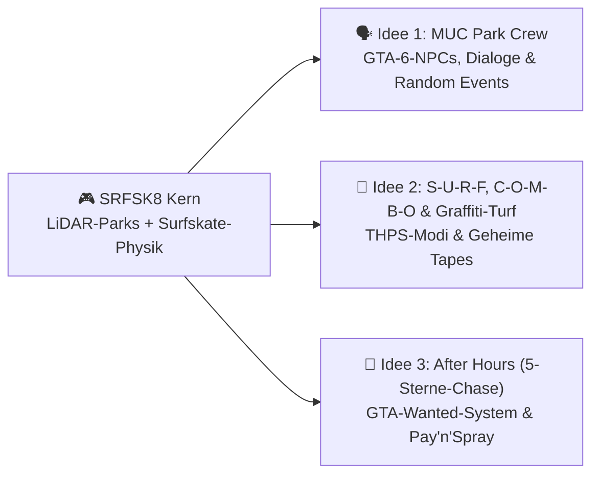

# SRFSK8 — 3 Konzepte für mehr Spieltiefe, Überraschungen & Langzeitspaß (THPS × GTA 6)

> **Ticket:** GitHub Issue [#34](https://github.com/michikarg-ai/surfsk8_game/issues/34) (*„Neue Spielideen“*)  
> **Ziel:** Drei eigenständige, mittelfristig umsetzbare Konzepte, die *SRFSK8* über das reine Highscore-Carven hinaus lebendig, überraschend und wiederspielbarer machen — inspiriert von **Tony Hawk’s Pro Skater (THPS)** und **GTA 6**.  
> **Standort- & Technik-Basis:** Geprüft gegen die reale Codebasis in `src/` (Three.js + LiDAR-Terrain + bestehende Systeme).

---

## 1. Kurz-Check: Was SRFSK8 heute schon stark macht (und wo noch Potenzial schlummert)

Ein Blick in die aktuelle Architektur zeigt, dass *SRFSK8* bereits ein beachtliches Fundament besitzt:

- **Zwei echte Münchner LiDAR-/Photogrammetrie-Parks ([`ImGefildeScene.ts`](../src/world/ImGefildeScene.ts), [`ParkSurface.ts`](../src/physics/ParkSurface.ts)):**
  - *Im Wiesengrund / Im Gefilde:* Nacht-Flutlicht & Alpen-Himmel (plus `golden_hour`-Toggle), inklusive *Central Volcano Dome*, *NW Over-Vert Cradle*, *South Clover Bowl*, *SE Deep Bowl Pocket* und der *East Sunset Palm Mural Wall* samt `CopingSegment`-Grinds.
  - *Airport Skatepark (Hallbergmoos):* Golden-Hour-Atmosphäre direkt in der Einflugschneise von MUC mit *Runway Spine*, *Terminal Bowl*, *Tower Extension* und *Gate Transfer Hip*.
- **Kinetik, Modi & Progression ([`SurfskateController.ts`](../src/physics/SurfskateController.ts), [`SurfProgression.ts`](../src/progression/SurfProgression.ts), [`LeaderboardService.ts`](../src/services/LeaderboardService.ts)):**
  - 2 differenzierte Charaktere (*Lukas* & *Sophie*), 5 Kern-Tricks (`SNAP`, `LAYBACK`, `BERTSLIDE`, `REVERSE360`, `INDYGRAB`) + Coping Grind, **Surf-Zone Overdrive** (`≥ 80 %` Flow → `1,5x` Punkte & `+8 %` Max-Speed) und **Perfect Pump** Timing-Feedback.
  - 3 Spielmodi (**2-Min Jam** inkl. Overtime & 2x `HotSpotZone`, **Flow Cup** mit 3-stufigen `FlowLineChallenge`-Tiers & holografischem `FlowGhostSkater`, **Free Surf Zen**), 6 Skater-Ränge (*Grom* bis *Soul Surfer Legend*), globales Upstash-Redis-Leaderboard und DE/EN-Lokalisierung (`i18n.ts`).
- **Ungenutztes Potenzial in der Spielwelt:**
  - `ScooterRiderNPC.ts` fährt aktuell alle 5 Minuten (erster Run nach 25 s) rein skriptbasiert in *Im Wiesengrund* — ohne jede Interaktion, Kollision oder Reaktion auf den Spieler.
  - `AirportFlyover.ts` lässt alle 5 Minuten (erster Überflug nach 18 s) eine detaillierte A320 über den *Airport Skatepark* donnern — bisher rein visuell/akustisch ohne Gameplay-Verknüpfung.
  - `PretzelCollectibles.ts` platziert 5 statische Brezeln an festen Weltkoordinaten; der **`BOARD`**-Reiter auf `LandingPage.ts` zeigt bislang nur einen Platzhalter-Hinweis (`boardNoticeView`).

Genau an diesen Stellen setzen die drei folgenden Konzepte an: Sie machen aus der beeindruckenden 3D-Kulisse eine **reaktive, verspielte Welt voller Charakter, Risiko und versteckter Geheimnisse**.

---

## 2. Die 3 Konzepte im Detail

---

### Idee 1: „MUC Park Crew & Random Encounters“ — Lebendige GTA-6-NPCs, Dialog-Quests & Spontan-Events

#### Pitch & Inspiration
- **Inspiration:** **GTA 6** (*Random World Events*, *Strangers & Freaks*, Passanten mit dynamischen Reaktionen und Situationskomik) × **Tony Hawk’s Pro Skater 3 / Underground** (Park-Locals an der Bowl-Kante ansprechen, die knackige 20-Sekunden-Side-Challenges ausrufen).
- **Warum das SRFSK8 enorm bereichert:** Bisher ist der Spieler allein auf Beton (abgesehen von einem stummen Scooter-Bot alle 5 Minuten). Lebendige Locals mit bayerischem Schmäh, Reaktionen auf die Tricks des Spielers und zufällige Mini-Ereignisse verwandeln beide Parks in echte Orte, an denen man *immer wieder* Neues entdeckt.

#### Konkreter Gameplay-Loop & Momente im Spiel
1. **Proximity-Interaktion (`[E]` / Touch-Sprechblase „Reden“):**
   Bremst der Spieler (`speed < 2,5 m/s`) in der Nähe eines NPCs ab, ploppt ein kleines GTA-ähnliches Dialog-Fenster (bilingual DE/EN über `i18n.ts`, begleitet von kurzen synthetischen Text-Beeps) auf:
   - **Im Wiesengrund — „Leo, das Scooter-Kid“ (`ScooterRiderNPC`-Upgrade):**
     Zwischen seinen Runs steht Leo lässig an der *East Sunset Palm Mural Wall*. Spricht man ihn an, liefert er freche Sprüche (*„Oida, fährst du Surfer-Teil oder willst nur chillen?“*) und bietet auf Knopfdruck ein **20-Sekunden-Duell**: *„Schaff vor mir 2x einen SNAP am Central Volcano — sonst gehört der Spot mir!“*
     - **„Snaked!“-Easter-Egg:** Kreuzt man Leos Weg während seines aktiven Stunt-Runs mit `> 6 m/s` im Abstand `< 1,8 m`, löst **„⚠️ SNAKED THE SCOOTER KID! +350 PTS“** aus — Leo flucht über seine 3D-Sprechblase (*„EY! SCHAU WO DU HINFÄHRST!“*) und macht einen slapstick-artigen Mini-Abgang (Anspielung auf das berüchtigte *„Fuck Scooters“*-Volcano-Graffiti!).
   - **Im Wiesengrund — „Grantler-Opa Sepp & Dackel Wasti“ (Versteckter Rand-NPC):**
     Sitzt auf einer Parkbank nahe dem *South Clover Bowl*. Anfangs schimpft er ur-münchnerisch (*„Des Gscherr auf de Rollbrettl macht mein Dackel ganz narrisch!“*). Landet der Spieler direkt in seinem Sichtfeld einen sauberen `BERTSLIDE` oder `SNAP`, schlägt seine Laune um (*„Ja mei… a so a Eleganz! Da, nimm mei Brezn!“*) — und er wirft eine **Goldene Geheim-Brezel (+1.500 PTS)** in den Bowl!
   - **Airport Skatepark — „MUC Planespotter Michi“:**
     Steht mit Teleobjektiv am Zaun Richtung Rollbahn. Sobald die A320 aus `AirportFlyover.ts` im Anflug ist, ruft er begeistert Flugnummern aus (*„Lufthansa 410 nach LAX! Zieh nen Indy Grab im Flügel-Schatten!“*). Gelingt dem Spieler während der 13-sekündigen Überflug-Phase ein **`INDYGRAB` oder hoher Air direkt im beweglichen Flugzeug-Bodenschatten**, zündet der **„✈️ JETWASH STUNT! +2.000 PTS“** inkl. Kamera-Blitzlicht vom Spotter!
2. **Random Ambient Events (alle ~50–80 Sekunden zufällig ein Mini-Ereignis):**
   - **🕊️ Tauben-Schwarm auf dem Volcano:** 4–5 Low-Poly-Tauben picken auf dem *Central Volcano Dome* (*Im Wiesengrund*) oder der *Runway Spine* (*Airport*). Carvt man knapp an ihnen vorbei, flattern sie erschrocken hoch (*„🕊️ PIGEON SCATTER! +250“*).
   - **📸 Insta-Filmer-Drohne:** Eine kleine blinkende Drohne begleitet den Spieler 12 Sekunden lang im Tiefflug. Bleibt man dabei über `80 %` Flow (**Surf-Zone**), gibt es den Bonus **„📸 VIRAL REEL CLIP! +800“**.
   - **🥨 Fallschirm-Brezel-Drop:** Im *Free Surf Zen* oder *2-Min Jam* schwebt sporadisch eine blinkende Mystery-Brezel an einem Mini-Fallschirm in einen zufälligen Bowl-Pocket (nur 12 s aktiv).

#### Warum es perfekt zu SRFSK8 passt & Technische Machbarkeit
- **Wiederverwendung bestehender Systeme:**
  - `ScooterRiderNPC.ts` bringt bereits den kompletten CC0-MakeHuman-Loader (`/models/skater.glb`), `BONE_ALIASES`, Two-Bone-IK und das `CanvasTexture`-Callout-Sprite-System mit — daraus lassen sich problemlos weitere stehende/reaktive Park-NPCs mit einfachen Idle-/Klatsch-Posen ableiten.
  - `AirportFlyover.ts` exponiert bereits `isActive()` und berechnet jeden Frame die exakte Bodenposition `shadowGroup.position` auf dem Beton (`y = 0.04`). Eine Abfrage `Math.hypot(skater.x - shadow.x, skater.z - shadow.z) < 9.0 && !controller.isGrounded` genügt für das Jetwash-Easter-Egg!
  - `ParkSurface.sample(x, z)` hält alle NPCs und Tauben exakt auf dem LiDAR-Mesh; `SurfAudio.ts` erzeugt leichte Text-Beeps prozedural über WebAudio (0 KB Asset-Ballast).

#### MVP-Scope & Geschätzter Aufwand
- **MVP-Umfang:** Interaktiver Upgrade-Scooter-NPC (Dialog + 20s-Wette + „Snaked!“-Reaktion) + 1 Airport-Planespotter-NPC inkl. A320-Jetwash-Bonus + 1 Random Event (*Taubenschwarm*).
- **Aufwand (T-Shirt / Tokens):** **M–L (~45k–65k Tokens)** · *Hybrid:* `pro` für 3D-NPC-Logik, Trigger & Jet-Shadow-Abgleich; `flash` für Dialog-Overlay-UI & `i18n`-Texte.

---

### Idee 2: „S-U-R-F, C-O-M-B-O & Graffiti-Turf“ — THPS-Arcade-Herausforderungen, Park-Eroberung & Geheime Tapes

#### Pitch & Inspiration
- **Inspiration:** **Tony Hawk’s Pro Skater 2/4** (*S-K-A-T-E*-Buchstaben, die schweißtreibende *C-O-M-B-O*-Einzelketten-Jagd, *Graffiti-Modus* und versteckte *Secret Tapes*) + **GTA San Andreas / GTA 6** (*Turf Tagging / Revier-Markierung*).
- **Warum das SRFSK8 enorm bereichert:** *Free Surf* ist entspannt und *2-Min Jam* prüft den Gesamtscore, aber es fehlt noch die ikonische **räumliche Puzzle- & Combo-Spannung**, bei der der Spieler den gesamten Park in einer einzigen flüssigen Linie verknüpfen muss und einzelne Park-Zonen sichtbar für sich beansprucht.

#### Konkreter Gameplay-Loop & Momente im Spiel
1. **„S-U-R-F“ & Hardcore-Modus „C-O-M-B-O“ (Buchstaben-Jagd in beiden Parks):**
   - **`S-U-R-F` Hunt (Mid-Core):** Vier leuchtende 3D-Buchstaben hängen über markanten Signature-Lines (z. B. *Im Wiesengrund*: über der *East Palm Wall*, dem *Volcano*, dem *NW Upper Spine Roller* und dem *SE Deep Bowl*; am *Airport*: über *Runway Spine*, *Terminal Bowl*, *Tower Extension* und *Gate Hip*). Einmal pro Run einsammeln = **+2.500 PTS** + Missions-Fortschritt.
   - **`C-O-M-B-O` Challenge (Adrenalin pur):** Die 5 Buchstaben `C – O – M – B – O` bilden eine logische, geschwungene Carve-Route. **Die gnadenlose THPS4-Regel:** Alle 5 Buchstaben müssen **in einer einzigen ununterbrochenen Combo** eingesammelt werden (`SurfHUD.comboTimeout > 0` / kein Bail)! Der Spieler pumpt, setzt zwischen den Buchstaben gezielte `BERTSLIDE`s, `SNAP`s oder `REVERSE360`s, um den Combo-Timer am Leben zu halten. Bricht die Combo oder passiert ein Wipeout, spawnen alle `C-O-M-B-O`-Buchstaben sofort zurück. Wer alle 5 in einer Kette landet, kassiert **+5.000 PTS**, Zeitlupen-Finale und einen Spezial-Badge!
2. **„GRAFFITI TURF“ — Park-Zonen in der eigenen Farbe erobern:**
   - Die bereits in `ParkSurface.getZoneName` und `HotSpotZone.ts` definierten Zonen (z. B. *Central Volcano*, *NW Cradle*, *Sunset Palm Wall*, *South Clover*, *Runway Spine*, *Terminal Bowl*) werden zu **6–8 Turf-Sektoren**.
   - Jeder saubere Trick oder `Perfect Pump` innerhalb eines Sektors „sprüht“ ein leuchtendes Neon-Muster (passend zur Skater- oder Deck-Farbe) auf den Betonrand der Zone und speichert dort deinen Trick-Score (z. B. *„VOLCANO: 1.450 PTS — LUKAS“*).
   - **Rivalen-Twist (Singleplayer vs. Crew-Ghost):** Im Graffiti-Modus übernimmt alle 25 Sekunden ein NPC-/Ghost-Skater (`FlowGhostSkater`) eine ungeschützte Zone mit lila Scooter-Tag, solange dein dortiger Trick-Score unter `1.200` liegt. Ziel am Ende der 2 Minuten: **Alle Zonen halten** oder einen möglichst hohen „Turf-Gesamtscore“ ins globale `LeaderboardService`-Ranking eintragen!
3. **Versteckte „MUC Secret Tapes“ (Audio- & Garage-Easter-Egg):**
   - Pro Skatepark versteckt sich **1 schimmerndes Retro-Kassettentape** an einem extrem hoch gelegenen Spot (z. B. weit über der Lip der *Sunset Palm Wall* oder ganz oben an der *Tower Extension* am Airport), der nur über **Surf-Zone Overdrive (`+8 %` Speed) + `Perfect Pump` + Ollie** erreichbar ist.
   - Einsammeln schaltet dauerhaft in `localStorage` einen **versteckten 4. Bonus-Soundtrack-Track** in `SurfAudio.ts` (z. B. bayerischen Synthwave / Surf-Lo-Fi) sowie ein exklusives **Secret-Deck** für den bislang leeren `BOARD`-Reiter auf `LandingPage.ts` frei!

#### Warum es perfekt zu SRFSK8 passt & Technische Machbarkeit
- **Wiederverwendung bestehender Systeme:**
  - `PretzelCollectibles.ts` liefert bereits die komplette Technik für rotierende 3D-Collectibles mit additivem Glow-Ring und Zero-Allocation-`InstancedMesh`-Partikeln (ideal für Buchstaben und Secret Tapes, ganz ohne Shader-Stutter durch `PointLight`s!).
  - `HotSpotZone.ts` besitzt bereits `confromGeometryToSurface(...)`: Damit lassen sich die neonfarbenen Turf-Markierungen direkt auf die gekrümmten LiDAR-Bowls projizieren, ohne die 4K-Photogrammetrie-Texturen (`skatepark_multi_tex0.jpg`, `airport_skatepark_tex0.jpg`) zu verändern.
  - `SurfskateController.ts` und `SurfHUD.ts` verwalten schon exakt `comboMultiplier`, `comboTimeout` und `isBailing`, sodass der `C-O-M-B-O`-Reset deterministisch und sauber angebunden werden kann.
  - `SurfAudio.ts` unterstützt bereits eine dynamische `playlist` inkl. `onTrackChange` — ein freischaltbarer Secret-Track fügt sich nahtlos ein.

#### MVP-Scope & Geschätzter Aufwand
- **MVP-Umfang:** `S-U-R-F` + `C-O-M-B-O`-Buchstaben-Challenge in beiden Parks + je 1 verstecktes Secret Tape (schaltet Secret-Track + HUD-Badge frei) + Turf-Ring-Visualisierung pro eroberter Park-Zone.
- **Aufwand (T-Shirt / Tokens):** **M (~35k–50k Tokens)** · *Hybrid:* `pro` für Buchstaben-Positionierung, `C-O-M-B-O`-State-Machine & Turf-Zonen-Projektion; `flash` für HUD-Buchstaben-Indikator & Modus-/Garage-UI.

---

### Idee 3: „AFTER HOURS: 5-Sterne Park-Verbot“ — GTA-Wanted-Chase, Outlaw-Multiplikator & Pay’n’Spray-Versteck

#### Pitch & Inspiration
- **Inspiration:** **GTA 6 / GTA-Reihe** (das ikonische *Wanted-Sterne-System `★☆☆☆☆ → ★★★★★`*, Polizei-Drohnen/Heli-Suchscheinwerfer und *Pay’n’Spray* zum Abtauchen) × klassische **Skate-Rebellion** (Ordnungsamt/Park-Security nach 22 Uhr austricksen, „No Skateboarding“-Schilder umfahren).
- **Warum das SRFSK8 enorm bereichert:** *Free Surf Zen* bedient Entspannung, *Flow Cup* bedient Präzision — ein optionaler **Adrenalin-Flucht-Modus** (oder versteckter Nacht-Trigger) erzeugt eine völlig neue Dynamik: Plötzlich sind **deine Surfskate-Fähigkeiten (Pumpen in steilen Wänden, Air-Transfers über den Volcano)** buchstäblich dein Fluchtwerkzeug!

#### Konkreter Gameplay-Loop & Momente im Spiel
1. **Wie der „Heat“ startet (2 Wege — direkt wählbar oder als verstecktes Easter Egg):**
   - **Als eigener Fun-Modus „🚨 AFTER HOURS“** in der Modus-Auswahl (`LandingPage.ts`), **oder**
   - **Als geheimes Nacht-Easter-Egg** in `mode === 'night'` (*Im Wiesengrund*): Am Parkrand stehen 3 kleine **„SKATEN NACH 22 UHR VERBOTEN“**-Pylone/Schilder. Fährt der Spieler alle 3 um (oder landet in Sichtweite des Ordnungsamts eine 4.000-Punkte-Combo), blinken oben rechts im `SurfHUD` klassische **GTA-Fahndungssterne** auf!
2. **Die 5-Sterne-Eskalation (Risiko vs. Belohnung):**
   - ★ **1 Stern — „Ordnungsamt-Pfiff“:** Ein Security-Guard in gelber Warnweste betritt zu Fuß den Parkrand, schwenkt einen sichtbaren **Taschenlampen-Lichtkegel** über den Beton und ruft via 3D-Sprechblase (*„Feierabend! Runter vom Beton!“*).
   - ★★ **2 Sterne — „Segway-/E-Patrouille“:** Ein schneller Park-Wächter auf einem blinkenden E-Balance-Roller nimmt die Verfolgung durch die flacheren Bereiche auf.
     - **Der Surfskate-Physik-Kniff:** Alle Verfolger prüfen über `ParkSurface.sample(x, z)` die Steigung und können **nur auf flachem Boden (`slope < 0,35`) fahren**! Wer sich in den *SE Deep Bowl*, die *NW Over-Vert Cradle* oder über den *Central Volcano Dome* pumpt, hängt die Verfolger physikalisch elegant ab!
   - ★★★ **3 Sterne — „Überwachungs-Drohne“:** Eine blinkende Polizei-/Park-Drohne kreist über den Bowls und projiziert einen rot-blauen Scheinwerferkreis auf die Transitions. **Risk/Reward-Clou:** Tricks *innerhalb* des Suchscheinwerfers bringen den **„🚨 OUTLAW MULTIPLIER (2,5x)“** — bleibt man aber länger als 3 Sekunden voll im Kegel oder wird vom Wächter geschnappt (`< 1,5 m`), endet die Flucht mit einem witzigen *„BUSTED! (Platzverweis)“*-Banner!
   - ★★★★–★★★★★ **4–5 Sterne — „MUC Heli-Spotlight“:** Ein riesiger wandernder Suchscheinwerfer von oben fegt über den gesamten Park, Blaulicht-Schimmer pulsiert am Horizont, und der Soundtrack legt einen spannungsgeladenen Chase-Filter auf (`SurfAudio.ts`). Überlebt man **15 Sekunden** und springt einmal über eine Lip oder über den Volcano, brechen die Sterne mit **„✅ ESCAPED THE HEAT! +3.000 PTS“** ab.
3. **Das kultige „Bavarian Pay’n’Spray“-Easter-Egg:**
   - Fährt der Spieler während einer aktiven Verfolgung in den schattigen Schlupfwinkel direkt hinter der *East Sunset Palm Mural Wall* (oder schaltet während der Flucht per `Taste` die Atmosphäre von `night` auf `golden_hour` um), blinkt das Board kurz auf und alle Fahndungssterne verschwinden sofort mit dem GTA-Augenzwinkern: **„🎨 SPRAYED & LOST THE HEAT!“**

#### Warum es perfekt zu SRFSK8 passt & Technische Machbarkeit
- **Wiederverwendung bestehender Systeme:**
  - `ImGefildeScene.ts` liefert bereits die perfekte Nacht-Flutlicht-Bühne (`mode === 'night'`) inkl. `toggleAtmosphere()`.
  - `ParkSurface.sample(x, z)` liefert `slopeX` und `slopeZ` in Echtzeit — damit lässt sich die „Verfolger-bleiben-im-Flat-hängen“-KI in ~30 Zeilen Vektor-Mathematik ohne komplexes NavMesh umsetzen.
  - `HotSpotZone.ts` zeigt, wie man leuchtende Boden-Kegel/Ringe (`RingGeometry` mit `AdditiveBlending`, **ohne** teure `THREE.PointLight`s!) verzögerungsfrei auf schräge Bowl-Flächen projiziert — genau so funktionieren Taschenlampen-Kegel, Drohnen-Spotlights und der Heli-Suchscheinwerfer bei konstanten 60 FPS.
  - Das Security-3D-Modell nutzt denselben leichtgewichtigen MakeHuman-/Low-Poly-Ansatz wie `ScooterRiderNPC.ts`.

#### MVP-Scope & Geschätzter Aufwand
- **MVP-Umfang:** 3 umfahrbare Verbotsschilder als Nacht-Easter-Egg + 1–3 Fahndungssterne (Taschenlampen-Security im Flat + 1 Suchscheinwerfer-Drohne mit `2,5x` Outlaw-Bonus) + „Pay’n’Spray“-Reset + `★★★★★`-HUD-Anzeige.
- **Aufwand (T-Shirt / Tokens):** **M–L (~45k–60k Tokens)** · *Hybrid:* `pro` für Verfolger-Slope-KI, Spotlight-Kollision & Escape-State-Machine; `flash` für `★`-HUD, Busted/Escaped-Overlays & `i18n`.

---

## 3. Vergleich & Empfohlene Reihenfolge (Mittelfristige Roadmap)

| Idee | Haupt-Inspiration | Spielerischer Fokus | Stärkster USP für SRFSK8 | MVP-Größe |
| :--- | :--- | :--- | :--- | :--- |
| **1. MUC Park Crew & Random Encounters** | **GTA 6** *(Random Events & NPCs)* + **THPS** *(Park-Quests)* | Lebendige Welt, Humor, spontane Abwechslung | Bindet bestehenden `ScooterRiderNPC` & `AirportFlyover` (Jetwash-Stunt!) endlich spielerisch ein | **M–L** (~45k–65k Tokens) |
| **2. S-U-R-F, C-O-M-B-O & Graffiti-Turf** | **THPS** *(C-O-M-B-O, Graffiti, Secret Tapes)* + **GTA** *(Turf)* | Skill-Tiefe, Linien-Puzzle, Wiederspielwert | Nutzt `PretzelCollectibles`- & `HotSpotZone`-Tech; füllt `BOARD`-Tab & `SurfAudio` mit Secret-Unlocks | **M** (~35k–50k Tokens) |
| **3. After Hours: 5-Sterne Park-Verbot** | **GTA 6** *(Wanted-Sterne, Chase, Pay’n’Spray)* | Adrenalin, Risk/Reward, Nacht-Action | Macht Surfskate-Wall-Pumping zur Flucht-Mechanik gegen Flat-Verfolger | **M–L** (~45k–60k Tokens) |

### Empfehlung für den nächsten Schritt
1. **Schnellster Mehrwert (Sprint A — Idee 2 MVP):** `S-U-R-F` / `C-O-M-B-O` + Secret Tape baut zu ~80 % auf bestehender `PretzelCollectibles`- und `SurfHUD`-Combo-Logik auf und gibt sofort frische Herausforderungen für beide Parks.
2. **Größter „Wow & Viral“-Faktor (Sprint B — Idee 1 MVP):** Ein ansprechbarer Scooter-Kid-Rivale + Airport-Spotter mit A320-Jetwash-Bonus sorgt auf TikTok/Instagram (`9:16` Reel-Mode!) und beim Ausprobieren für sofortige Schmunzel-Momente.
3. **Maximaler Adrenalin-Contrast-Modus (Sprint C — Idee 3 MVP):** Der 5-Sterne-Nacht-Chase setzt dem Ganzen als überraschendes Easter Egg bzw. Arcade-Modus die Krone auf.
